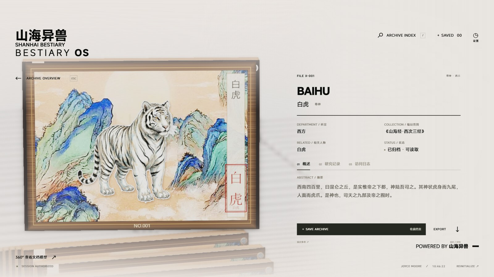
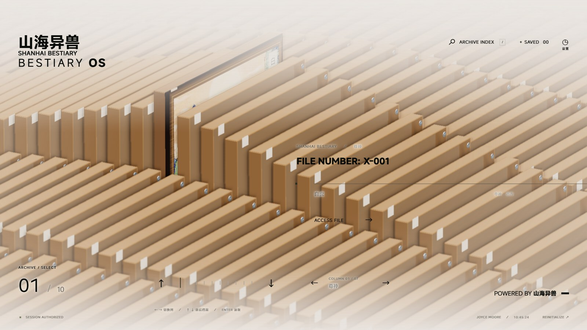
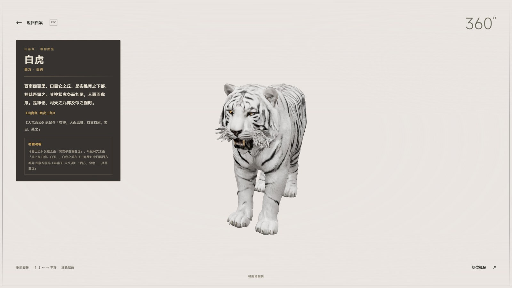
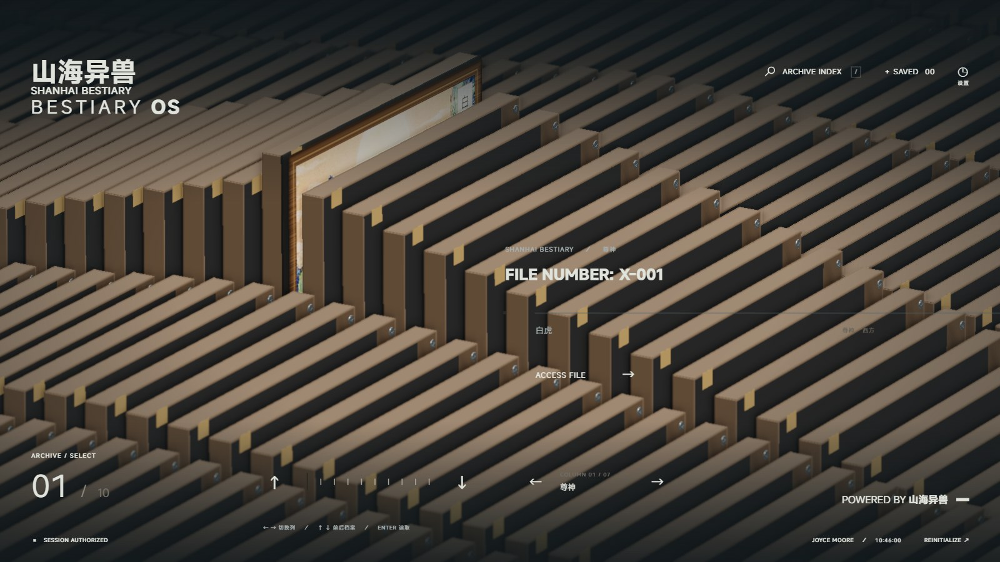

# 山海异兽 · SHANHAI BESTIARY OS

把《山海经》的七十只神兽，做成一座可以翻阅的**三维档案馆**。

木框展柜在阵列里层层排开，抽出任意一格，就是一只神兽的展框——青绿山水为底，工笔立绘居中，右侧竖排题签与朱砂印。打开档案，可见原文、释义与考据；再点「360°」，那只神兽便在左侧考据卡旁缓缓转出来。



## 快速开始

```bash
npm install
npm run dev        # → http://127.0.0.1:5173/
```

Windows 上也可直接双击 `start-console.bat`（首次会自动安装依赖）。

```bash
npm run build      # 产出 dist/
npm run preview    # 预览构建结果 → http://127.0.0.1:4173/
```

需要 **Node.js 22.12 或更高版本**，以及支持 WebGL 2 的现代桌面浏览器。首次安装依赖需要网络；应用不需要 API Key，也不启动后端服务。

## 界面一览

| 画面 | 说明 |
| --- | --- |
| **阵列** | 七列展柜，每列十只神兽。左右切列、上下翻阅，首尾循环；悬停任意展柜会高亮并显示编号。 |
| **展框** | 抽出的档案放大成展框：木框 + 青绿山水 + 工笔立绘 + 竖排题签。 |
| **档案** | 右侧是完整资料——出处、原文、释义、考据记录，可收藏、导出 TXT。 |
| **360°** | 该神兽的 3D 模型，可拖动环绕、滚轮缩放、方向键平移。 |

### 阵列页



阵列由七列构成，每列十只，合计七十只神兽。切列与翻阅均可持续循环，切回某列时保留上次选中的位置。

### 档案详情


选中展柜后抽出的封面，与右侧档案资料同屏呈现：所处山名、编目范围（《山海经》篇目）、原文摘要，以及可收藏、导出 TXT 的操作。封面下方即「360° 查看神兽模型」入口。

### 360° 神兽模型



每一只神兽都有对应的 3D 模型。查看器左侧是介绍卡：分类与特征、原文、出处、释义，以及一条考据摘录。

### 暗色模式

设置中可切换亮／暗配色，玻璃阵列与展框材质会逐张过渡，暗色下同样保留木框与立绘的颜色。



## 操作说明

| 操作 | 效果 |
| --- | --- |
| `←` / `→` | 切换神兽分类（列），首尾循环 |
| `↑` / `↓` | 翻阅同类神兽，首尾循环 |
| `Enter`、`ACCESS FILE` 或文件编号 | 打开当前档案 |
| 鼠标悬停展柜 | 高亮该柜并显示编号 |
| `／` 或 `ARCHIVE INDEX` | 打开检索，可搜编号、名称、英文名、所属山名、相关人物 |
| `SAVE ARCHIVE` / `SAVED` | 收藏 / 查看收藏 |
| `EXPORT` | 下载当前档案的 TXT |
| `Esc` | 关闭弹窗，或从详情返回阵列 |

360° 查看器内：拖动旋转、滚轮或 `+` / `−` 缩放、方向键平移、`Home` 复位视角、`Esc` 返回档案。

布局以 **1920 × 1080** 为基准等比例适应窗口，主要面向桌面与横向屏幕。设置页提供音效与背景音乐的独立开关与音量、完整／减少／自定义动画、四档画质预设、全屏与重新播放开场。收藏与偏好保存在浏览器本地。

## 内容与素材

| 位置 | 内容 |
| --- | --- |
| `content/archives.json` | 七十条档案：名称、英文名、分类、出处、原文、释义、考据 |
| `public/assets/sixiang/panels/` | 七十张展框封面（1200 × 888，JPEG） |
| `public/assets/sixiang/panels-atlas.*` | 阵列用的贴图集与 UV 索引 |
| `public/assets/sixiang/models/` | 七十个神兽 GLB（glTF 压缩，约 0.9 MB/个，合计 57 MB） |
| `public/archives/` | 导出的档案 TXT，由构建时自动生成 |

档案字段与修改步骤见 [`content/README.md`](content/README.md)。

### 封面与模型是怎么来的

- **封面**：`snow/make_rhine_covers.py` 把工笔立绘合成到木框版式上——山水底图、竖排题签、朱砂印、底部编号，输出 1200 × 888 的 JPEG。
- **贴图集**：`snow/make_rhine_atlas.py` 把 70 张封面拼成一张图集并生成 UV 索引，供阵列中的展柜共享同一张纹理。
- **模型**：`snow/assets/sixiang/*.glb` 经 gltf-transform 压缩（纹理转 WebP、限长 1024）后放入 `public/assets/sixiang/models/`。

```bash
npx @gltf-transform/cli optimize --texture-compress webp --texture-size 1024 in.glb out.glb
```

> 改动封面后，记得同步更新 `src/scene.ts` 里的 `PANEL_ASSET_VERSION`，否则浏览器会命中旧缓存。

## 工程结构

| 目录或文件 | 内容 |
| --- | --- |
| [`src/main.ts`](src/main.ts) | 页面状态、档案阅读、检索、收藏与快捷键 |
| [`src/scene.ts`](src/scene.ts) | Three.js 场景、展柜阵列、抽取与归位、展框贴图 |
| [`src/model-viewer.ts`](src/model-viewer.ts) | 360° 查看器与神兽模型加载 |
| [`src/appearance.ts`](src/appearance.ts)、[`src/theme-material.ts`](src/theme-material.ts) | 材质接管与亮暗主题配色 |
| [`src/brand.ts`](src/brand.ts)、[`src/boot.ts`](src/boot.ts) | 品牌标识与开场动画 |
| [`src/style.css`](src/style.css) | 界面样式与主题变量 |
| [`content/archives.json`](content/archives.json) | 页面与下载共用的档案数据 |
| [`src/data.ts`](src/data.ts) | 档案类型与阵列位置映射 |
| [`public/assets/sixiang/`](public/assets/sixiang/) | 展框封面、贴图集与神兽模型 |
| `docs/media/` | README 配图 |

### 本地调试路径

| 路径 | 用途 |
| --- | --- |
| `/?scene=archive` | 直接进入档案阵列 |
| `/?scene=detail` | 直接进入档案详情 |

### 校验脚本

```bash
npm run check:content
node scripts/check-appearance.mjs
node scripts/check-assembly.mjs
node scripts/check-decryption.mjs
```

这些脚本检查数据规则、材质外观、装配结构与解密轨迹。视觉效果仍需在浏览器中实际查看。

## 许可与出处

本项目采用 [MIT License](LICENSE)。内容层（七十只神兽的数据、封面、模型）与木框展柜外观为本项目原创；三维档案界面、相机、阵列与查看器骨架来自 [LBEILC/RhineLabUI](https://github.com/LBEILC/RhineLabUI)（同为 MIT），本项目在其之上替换了全部内容与外观。

- **MiSans**：使用小米官方字体文件，保留[字体许可](public/fonts/MiSans-license.pdf)及字体目录内的版权说明。
- **Rolling Number**：用于编号和文字滚动，许可见 [`public/licenses/rolling-number.txt`](public/licenses/rolling-number.txt)。
- **声音**：三轨配乐为本项目程序编配，处理记录见 [音频说明](public/audio/README.md)。
- **其他依赖**：各自遵循其原有许可，源码公开不改变第三方资源的权利。
